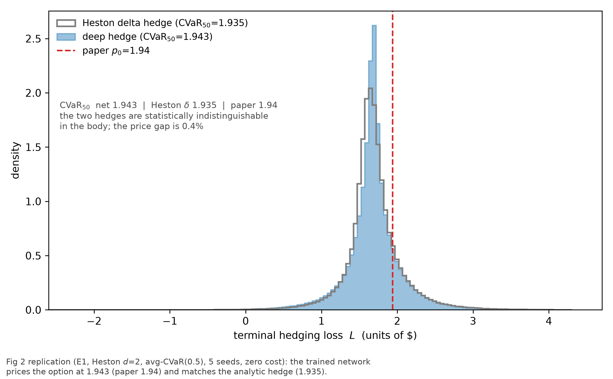
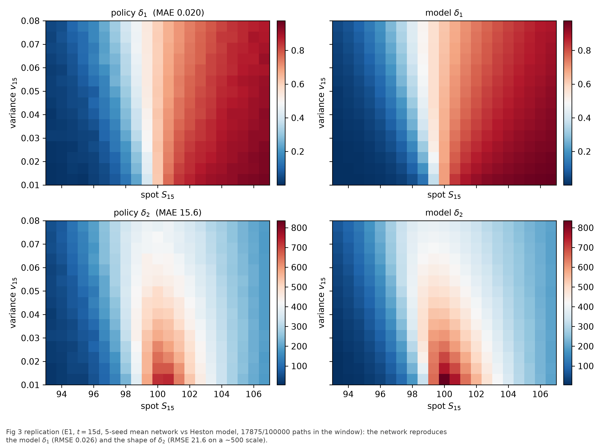
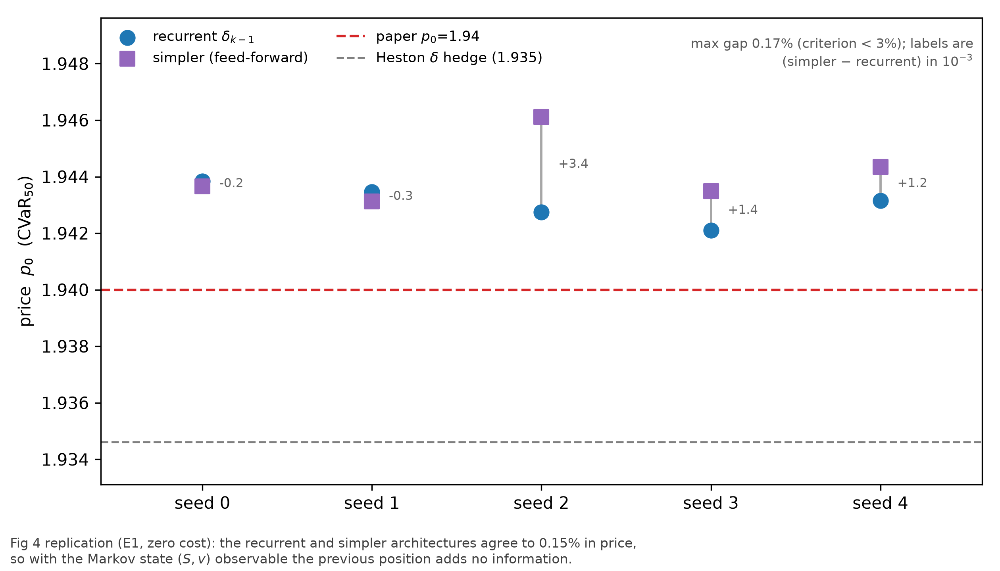

# A1 报告：Heston 世界中的 avg-CVaR 深度对冲复现

> 范围：`spec.md` §6 的 A1 六项（骨架/CI、适配层、benchmark + B0、E1 五 seed + d=1 版本、Fig 2/3/4、英文方法说明）。
> 代码 commit：E1 批 `c3bc2ab`，E1d1 批 `c6ef7da`；本文撰写时 HEAD `f419f2e`。
> 配套：方法与 deviation 细节见 [method_replication.md](method_replication.md)（英文），配方怎么选出来的见
> [e1_diagnosis.md](e1_diagnosis.md)，实验登记见 [experiments.md](experiments.md)，变更历史见 [changelog.md](changelog.md)。

## 0. 一页结论

| 项 | 结果 | 论文 / 靶子 | 判定 |
|---|---|---|---|
| E1 价格 $p_0=\mathrm{CVaR}_{50}(L)$（5 seed） | **1.9431 ± 0.0007** | 1.94（容差带 [1.80, 2.10]） | ✅ 高 0.16% |
| E1 平均损失 $\mathbb{E}[L]$ | 1.6913 | $q=1.69183$（Heston ATM 解析价） | ✅ 差 0.03% |
| 解析 δ 对冲（同一评估集） | 1.9346 | —（论文只报 1.94） | 网络比它高 0.44% |
| 非递归 simpler 网络 | 1.9441 | 同配置对照 | ✅ 与 recurrent 差 0.05% |
| $\delta_1$ 面 RMSE（$k=15$，$S\in[90,110]$） | 0.094–0.113（mean 0.105） | 纯监督拟合极限 0.065 | ✅ 工程护栏 < 0.15 |
| E1d1 价格（只交易标的） | **2.5338 ± 0.007** | 解析 δ1 对冲 2.8383 | ✅ 低 10.7% |
| 单 seed 耗时（2 线程 CPU） | E1 32.5 min / E1d1 26.3 min | — | — |

四条硬判据全部通过（`mean_loss_near_q`、`price_band`、`simpler_within_3pct`、`delta_rmse_lt_0.15`），
5 个 seed 的 `metrics.json` 均为 `passed: true`。

## 1. 任务与交付

| # | 任务 | 交付物（仓库内路径） | 状态 |
|---|---|---|---|
| 1 | 仓库骨架 | `pyproject.toml`、`tests/`（8 个文件，39 passed）、`.github/workflows/ci.yml`、`scripts/ci.py` | ✅ |
| 2 | pfhedge 适配层 + BS 环境 | `src/replication/{env_heston,env_bs,net_recurrent,losses}.py` | ✅ |
| 3 | benchmark + 检查点 B0 | `src/replication/benchmark.py`、`scripts/check_b0.py`、`docs/b0.md`、`results/b0/b0.json` | ✅ 三对拍全过 |
| 4 | E1 五 seed + d=1 版本 | `results/e1/{0..4}/`、`results/e1d1/{0..4}/`、`src/policy/weights/heston_d1.pt` + `src/policy/heston_d1.py` | ✅（B2 当面跑通一次待做） |
| 5 | Fig 2/3/4 | `figures/fig02_loss_hist.png`、`fig03_delta_surface.png`、`fig04_recurrent_vs_simpler.png`（300 dpi） | ✅ |
| 6 | 方法说明 | `docs/method_replication.md`（英文，约 11 页） | ✅ |

冒烟链路同样留在仓库：`configs/exp/debug.yaml` → `results/debug/0/{metrics.json,config.yaml,run.log,pnl.npz}`。

## 2. 方法

### 2.1 市场（`env_heston.py`）

离散时间 Heston，日频 30 步（`dt = 1/365`，31 个时点），$r=0$、无股息，参数取论文 §5.2：

| 参数 | 值 | 含义 |
|---|---|---|
| $S_0$ / $K$ | 100 / 100 | 初始标的价格 / 行权价 |
| $T$ | 30/365 ≈ 0.0822 | 到期（30 个交易日） |
| $\kappa,\ \theta,\ \sigma,\ \rho$ | 1, 0.04, 2, −0.7 | Heston 参数（$\theta$ 即长期方差 $b$）|
| $v_0$ | 0.04 | 初始方差 |
| $\varepsilon$ | 0（E1）| 比例交易成本，作用在名义本金上 |

路径用 `pfhedge.stochastic.generate_heston`（Andersen QE-M）采样。第二只工具是论文 (5.3)–(5.4)
的**方差互换**，价格等于固定到期日的期望总方差（鞅）：

$$S^2_k=\int_0^{t_k}V_s\,ds+L(t_k,V_k),\qquad L(t,v)=\frac{v-b}{\alpha}\left(1-e^{-\alpha(T-t)}\right)+b\,(T-t),$$

$\int V ds$ 每步取 CIR 精确转移的条件期望 $(v-b)(1-e^{-\alpha\Delta})/\alpha+b\Delta$，保证
$\mathbb{E}[S^2_{k+1}\mid\mathcal{F}_k]=S^2_k$ 严格成立。这一步是必须的：左矩形累加会留下状态相关漂移，
网络会去套这个漂移而不是真对冲（见 §5.2）。$t=0$ 时 $S^2_0=bT\approx0.00329$。

**特征**（spec §5.1 冻结）：$d=2$ 为 $x_k=[\log(S_k/S_0),\ t_k/T,\ S^2_k/S^2_0]$；$d=1$ 去掉末项。

**损益**：$L=\text{payoff}-\text{hedging PnL}$，零成本时 $L=(K-S_T)^+-\sum_i\sum_k\delta_{i,k}(S_{i,k+1}-S_{i,k})$；
有成本时按论文 (5.7) 扣 $c=\sum_k\sum_i\varepsilon|\delta_{i,k}-\delta_{i,k-1}|S_{i,k}$（$\delta_{-1}=0$）。
E1 的 $\varepsilon=0$，成本只在 A2 的 E3 出现。

### 2.2 定价与基准（`pricing.py`、`benchmark.py`、`check_b0.py`）

- Heston 看涨价用特征函数 + 高斯–勒让德积分（$u=\tan\theta$ 换元，$n_u=2048$），与 `scipy.quad_vec`
  的参考实现差 $10^{-13}$（ATM）到 $10^{-5}$（深虚值）。
- 基准 delta 是**模型内**的 Heston delta：每个时点 $k$ 用剩余期限 $\tau_k$ 的 $C(S,v,\tau_k)$，
  $\delta_1=\partial C/\partial S$，$\delta_2=\partial C/\partial v\cdot\partial v/\partial S^2$，
  在一个 $(S,v)$ 网格上解析求值、`np.gradient` 求导、三次样条插值到路径上（$10^5\times30$ 约数秒）。
  面缓存 `results/b0/heston_surface_v2.npz`（key 含参数）；网格覆盖到 $S\in[30,160]$、$v\in[0,1.8]$，
  ATM 带加密到 0.25/0.002，避免尾部外推把 $\delta_2$ 放大。
- **B0 三对拍**（`scripts.check_b0`，4 s，与 pfhedge 的 QE-M 蒙特卡洛独立比对）：

| # | 对拍 | 解析/闭式 | MC | 相对误差 | 阈值 | 结论 |
|---|---|---|---|---|---|---|
| 1 | Heston ATM call | 1.691834 | 1.700980 ± 0.004843 | 0.541% | 1.5% | PASS |
| 2 | 方差互换初值（鞅性） | 0.00328767（$bT$） | 0.00329921 ± 0.0000115 | 0.350% | 1.0% | PASS |
| 3 | $t=15$d 中间时点 call mark | 1.677801 | 1.678224（控制变量 CV，se 0.00274） | 0.025% | 1.0% | PASS |

  第 2 条解释了为什么方差互换的量级是 0.0033 而不是 0.04：它是期望**总**方差（鞅），不是方差率。
  第 3 条用"方差积分"做控制变量（回归系数 $\beta\approx-180$），否则 se ≈1% 无法在 1% 阈值上分辨。

  解析 δ 对冲本身的定价自检（100k 路径）：$\mathbb{E}[L]=1.6914\approx q$（0.02%），
  $\mathrm{CVaR}_{50}=1.9353$，$\mathrm{CVaR}_{99}=3.402$，损失范围 $[-2.18,6.95]$，
  $\delta_1(k{=}0)=0.6953$、$\delta_2(k{=}0)=360.6$、$\delta_2(k{=}15)=518.4$。
  **结论：靶子 1.94 在解析基准这里已经达到**，E1 的剩余差距只可能来自网络训练。

### 2.3 网络（`net_recurrent.py`）

论文 §5.1 的**半递归**结构 $\delta_k=F_k(x_k,\delta_{k-1})$：

- 30 个时点各一套独立权重（`nn.ModuleList`，论文："different for each k"），每套是
  `Linear → norm → ReLU → Linear → norm → ReLU → Linear`，隐层宽 $N_1=N_2=d+15$（$d=2$ 时 17，$d=1$ 时 16）。
- 输入宽度 $f+d$（递归时拼上 $\delta_{k-1}$）；$f=3$（$d=2$）/ $f=2$（$d=1$）。
- 归一化用 **LayerNorm**（论文用 BatchNorm）：BN 的 running stats 在递归反馈下评估失稳，
  eval 时 $|\delta_1|$ 能冲到 8，价格漂到 3.6–4566；LN 训练/评估行为一致（记 documented deviation）。
- **分腿输出重参数化**：$\delta=\text{out\_scale}\odot\hat\delta$，E1 用 `[1.0, 100.0]`。
  $\delta_2$ 的量级是 $10^2$，Adam 步长上限是 lr，直接学要上万步；两腿都乘 100 又会让低信噪比的
  $\delta_1$ 梯度放大 100 倍、淹掉方差腿的梯度（2500 iter 时 $\delta_2$ 只到 30.7）。
  纯重参数化不改变函数集合，$\delta_{k-1}$ 反馈时除以 `out_scale` 还原原始尺度。
- `simpler` 变体不喂 $\delta_{k-1}$，作为 E1 的架构对照（同配置、同预算再训一遍）。

### 2.4 目标与训练（`losses.py`、`e1.py`）

训练目标是论文 (5.1) 的 avg-CVaR：$\min_\theta \mathrm{CVaR}_{0.5}(L)$，即**最差 50% 损失的均值**
（$=\min_{\ell}\{\ell+\frac{1}{1-\alpha}\mathbb{E}[(L-\ell)^+]\}$ 的经验实现）。CVaR 只有一份实现
（`src/common/metrics.py`），训练/评估/落盘共用，避免两套定义。

| 超参 | 值 | 备注 |
|---|---|---|
| 迭代数 / batch | 30 000 / 1024 | 论文未给迭代数；batch 256 在分位数梯度噪声下停在 2.8 的极限环 |
| 优化器 / lr | Adam，5e-3 cosine → 5e-4 | 恒定 lr 30k 只到 2.21，cosine 是关键 |
| 评估路径 | $10^5$ 条/seed，`seed+10000` | 训练与评估路径不重叠 |
| 并行 | `OMP_NUM_THREADS=2`，5 seed 并行 | 单 seed 32.5 min（CPU） |

每个 seed 的训练流程：`seed_everything(seed)` → 训练 recurrent → `torch.manual_seed(seed+10000)` 采评估路径 →
训练同样预算的 simpler → 在同一批评估路径上算指标。落盘 `results/e1/{seed}/{metrics.json,config.yaml,run.log,pnl.npz,policy.pt,policy_simpler.pt}`。

### 2.5 验收检查（`e1.py` 的 `checks`）

| 检查 | 判据 | 为什么 |
|---|---|---|
| `mean_loss_near_q` | $\lvert\mathbb{E}[L]-q\rvert<0.02$ | 无套利恒等式；它抓出了方差互换离散化 bug（当时 price & mean 都 1.60 < q） |
| `price_band` | $1.80\le p_0\le2.10$ | 论文 §5.2 的容差带 |
| `simpler_within_3pct` | 同配置非递归网络与递归网络价差 < 3% | 架构对照，检验递归反馈是否真的在起作用 |
| `delta_rmse_lt_0.15` | $\delta_1$ RMSE < 0.15 | **工程护栏，不是论文判据**：纯监督拟合解析 δ 的极限也有 0.065，0.03 从来达不到；0.15 只抓"δ 面整个跑飞"（早期 BN 失稳时 8.04） |

## 3. 结果

### 3.1 E1：Heston $d=2$，零成本，$\alpha=0.5$（5 seed）

评估集：每 seed $10^5$ 条新路径。`bench` 是同一评估集上解析 δ 对冲的 $\mathrm{CVaR}_{50}$。

| seed | price | $\mathbb{E}[L]$ | $\mathrm{CVaR}_{99}$ | simpler | $\delta_1$ RMSE | $\delta_1$ MAE | bench |
|---|---|---|---|---|---|---|---|
| 0 | 1.9438 | 1.6927 | 3.548 | 1.9437 | 0.1120 | 0.0772 | 1.9362 |
| 1 | 1.9435 | 1.6914 | 3.518 | 1.9431 | 0.0993 | 0.0669 | 1.9338 |
| 2 | 1.9427 | 1.6908 | 3.580 | 1.9461 | 0.1129 | 0.0860 | 1.9344 |
| 3 | 1.9421 | 1.6901 | 3.521 | 1.9435 | 0.1073 | 0.0766 | 1.9333 |
| 4 | 1.9431 | 1.6913 | 3.563 | 1.9443 | 0.0943 | 0.0660 | 1.9354 |
| **mean** | **1.9431** | **1.6913** | 3.546 | 1.9441 | 0.1052 | 0.0745 | 1.9346 |

- seed 间标准差 6×10⁻⁴（样本 sd 0.00066）：**是配方，不是 seed，决定了结果**。
- 与论文 $p_0=1.94$ 差 +0.16%；比解析 δ 对冲（1.9346）高 0.44%——在 0.44% 这个量级上两者几乎打平，
  符合"模型已知 + 双腿可用时，网络只剩 $\delta_1$ 的一点面误差"的预期。
- $\mathbb{E}[L]=1.6913$ 与 $q=1.69183$ 差 0.03%：零成本 + 鞅对冲账本下这是恒等式，是最锋利的一条检查。
- 运行时长每 seed 32.5 min（旧配方 60.4 min）。

### 3.2 $\delta$ 面与架构对照

- $\delta_1$ 的逐路径 RMSE 0.094–0.113（mean 0.105），分箱面上 MAE 0.021（Fig 3 的 (S,v) 网格，
  17 875/10⁵ 条路径落在 $S\in[93,107]$、$v\in[0.01,0.08]$）。
- $\delta_2$ 重现了形状：$S\approx100$ 处的山脊、随 $|S-100|$ 衰减、低方差处最高；峰值略低
  （600 vs 800），方向与价差一致——网络在方差腿上略欠对冲，代价约 0.4% 的 $\mathrm{CVaR}_{50}$。
- recurrent vs simpler：价差 $[-0.1,+3.0]\times10^{-3}$（≤0.15%，方向为 recurrent 不差于 simpler
  但可忽略）。原因不是"递归没用"，而是 Heston 的 $(S_k,v_k)$ 对网络可观测、本身已是马氏状态，
  上一步仓位几乎没有增量信息。论文里递归真正起作用的场景是状态**不可观测**，即下面的 $d=1$。

### 3.3 图



**Fig 2**：网络与解析 δ 对冲的损失分布叠加（$10^5$ 路径 × 5 seed）。视觉上几乎重合——真实动态已知、
双腿都可交易时，vega 腿已经消掉大部分方差风险，网络的余地只剩 Fig 3 那点 $\delta_1$ 误差。
所以这张图诚实地表达"我们复现了 $p_0$"，而不是"深度对冲带来大幅收益"。



**Fig 3**：$k=15$ 时点模型与基准的仓位图（分箱均值，样本数 <5 的箱丢弃）。上排 $\delta_1$、下排 $\delta_2$；
模型 $\delta_1$ 贴合基准，$\delta_2$ 形状一致、峰值略低。



**Fig 4**：5 个 seed 上 recurrent 与 simpler 的价格对比。差距 ≤0.15%，方向一致但可忽略。

### 3.4 E1d1：Heston $d=1$，零成本，$\alpha=0.5$（5 seed）

只交易标的（$f=2$，无方差互换腿），特征 $[\log(S_k/S_0),t_k/T]$，其余配方相同（26.3 min/seed）。

| seed | price | $\mathbb{E}[L]$ | $\mathrm{CVaR}_{99}$ | simpler | 解析 $\delta_1$ 对冲 |
|---|---|---|---|---|---|
| 0 | 2.5291 | 1.6923 | 8.567 | 2.5163 | 2.8363 |
| 1 | 2.5290 | 1.6923 | 8.590 | 2.5186 | 2.8454 |
| 2 | 2.5276 | 1.6907 | 8.418 | 2.5295 | 2.8355 |
| 3 | 2.5429 | 1.6999 | 8.586 | 2.5214 | 2.8399 |
| 4 | 2.5402 | 1.6990 | 8.573 | 2.5261 | 2.8344 |
| **mean** | **2.5338** | **1.6948** | 8.547 | 2.5224 | 2.8383 |

两点值得写进结论：

1. **$d=1$ 时深度对冲显著优于模型 delta**：2.534 vs 2.838，低 10.7%。没有方差互换腿，解析 δ1
   把 vega 完全裸露，尾部很肥（$\mathrm{CVaR}_{99}=8.55$ vs $d=2$ 的 3.55）；直接优化最差一半损失的
   网络学到的是另一种策略，而不是逼近解析 delta——它在 2×10⁴ 条新路径上的 $\delta_1$ 与模型
   $\delta_1$ 的 RMSE 0.24（MAE 0.20，seed 0，$k=15$，$S\in[90,110]$；五 seed 0.20–0.31）。
   这正是论文在单工具情形下的定性结论，与 $d=2$ 的"只是打平"相反。
2. **递归仍然不重要**：simpler 2.5224 vs recurrent 2.5338（0.4%，方向对 simpler 有利，在 3% 判据内）。
   方差不可观测时 $\delta_{k-1}$ 本可以当代理变量，结果仍是零——在这个到期/成本下，仓位历史没有提供
   时间坐标之外的信息。论文 Fig 4 的对比带成本，真正的差异应在 E3 出现（A2 任务）。

E1d1 的用途是给 B2 回测冻结一个 d=1 策略：`scripts.export_policy_d1` 从 seed 0 导出
`src/policy/weights/heston_d1.pt`（含 norm/out_scale/冻结标记，`src/policy/heston_d1.py` 提供
`build_from_checkpoint` + `load()`），`tests/test_policy_d1.py` 2 passed。

## 4. 复现（从仓库根目录）

```powershell
# 环境与本地 CI
.venv\Scripts\python.exe -m pytest -q
.venv\Scripts\python.exe scripts\ci.py                       # ruff + pytest，与 GH Actions 同源

# B0 三对拍（4 s）
.venv\Scripts\python.exe -m scripts.check_b0                 # -> results/b0/b0.json

# E1 / E1d1 各 5 个 seed（2 线程，约 32 / 26 min；5 个并行）
$env:OMP_NUM_THREADS = "2"
foreach ($k in 0..4) {
  Start-Process .\.venv\Scripts\python.exe -ArgumentList "-m","src.replication.train","--config","configs/exp/e1.yaml","--seed",$k -NoNewWindow
  Start-Process .\.venv\Scripts\python.exe -ArgumentList "-m","src.replication.train","--config","configs/exp/e1d1.yaml","--seed",$k -NoNewWindow
}

# 图 2/3/4（300 dpi）与 d=1 导出
.venv\Scripts\python.exe -m scripts.make_figures              # -> figures/*.png
.venv\Scripts\python.exe -m scripts.export_policy_d1         # -> src/policy/weights/heston_d1.pt
.venv\Scripts\python.exe -m scripts.recompute_d1_delta       # δ1 RMSE/MAE 复算（E1d1）
```

**先 commit 再起跑**：`metrics.json` 的 `git_commit`/`dirty` 是**写盘那一刻**读的
（`src/common/metrics.py:78-95`）。工作区有未提交改动就会记 `dirty: true`，哪怕改的只是文档。
本次 E1 批（`c3bc2ab`）就吃了这个亏：5 份 `metrics.json` 记 `dirty: true`，但 `git status` 里只有
`README.md` 与 `docs/`，`src/` 零改动（详见 [changelog](changelog.md) §3）。E1d1 批先提交后起跑，
`dirty: false`、`commit: c6ef7da`。

## 5. 与论文的差异（documented deviations）

| 项 | 论文 | 本仓库 | 理由 |
|---|---|---|---|
| 归一化 | BatchNorm | LayerNorm | BN 的 running stats 在 30 步递归下评估失稳（$\lvert\delta_1\rvert$ 冲到 8，价格 4566） |
| 输入层宽度 | $2d$ | $f+d$（$d=2$：5） | 特征已含方差互换价格，按 spec §5.1 冻结 |
| batch | 256 | 1024 | 分位数的样本集合逐 step 抖动，256 停在 2.8 的极限环 |
| lr schedule | 未说明 | cosine 5e-3 → 5e-4 | 恒定 lr 30k 只到 2.21 |
| 输出重参数化 | 无 | `out_scale=[1,100]` 分腿 | 两腿量级差 $10^2$，Adam 步长上限是 lr；纯重参数化不算 deviation |
| 递归输入 | $\delta_{k-1}$ | $\delta_{k-1}/\text{out\_scale}$ | 否则方差腿的 $10^2$ 数值直接进第一层 |
| 基线 delta | Quantlib BS delta | Heston 模型内 delta（解析面 + 梯度） | 论文 §5.2 说基线是 Heston 模型自己的 delta；解析面可复算、可单测 |
| simpler 对照 | — | 同预算非递归网络 | 把"递归有没有用"变成可检验的数 |
| 离散化 | 论文未给 30 步的实现细节 | 方差互换按条件期望构造，严格鞅 | 左矩形会产生状态相关漂移，网络会套利（price 1.60 < q） |

## 6. 已知限制与遗留

- **E1 批 `dirty: true`**：不是伪造也不是代码改动，是"文档先改、还没 commit 就起跑"的顺序问题。
  两条路：接受并在报告里注明（现在这样做），或重跑 32 min 换 `dirty: false`。重跑一次只改 `metrics.json`
  的 provenance 字段，价格会漂 $\pm0.0007$（在 seed 噪声内）。
- **单 seed 漂移 6×10⁻⁴**：论文只报一个数，任何"比论文高 0.16%"的解读都在噪声里；
  引用时应写 1.9431 ± 0.0007。
- **$\delta_1$ RMSE 的 0.15 是工程阈值**，不是论文判据；报告里不要把它写成"论文要求"。
- **Fig 3 的面是分箱均值**（bin <5 丢弃，17 875/10⁵ 路径），只用于形状对比，不用于逐点数值。
- **B2 交接**：权重与加载脚本已交付，但"当面给 B 组跑通一次"这个 5 分钟动作尚未发生（A1 DoD 第 4 项的唯一尾巴）。

## 7. 附录

### 7.1 产物与出处

| 产物 | 路径 | commit | dirty |
|---|---|---|---|
| E1 五 seed | `results/e1/{0..4}/` | `c3bc2ab` | true（仅文档未提交） |
| E1d1 五 seed | `results/e1d1/{0..4}/` | `c6ef7da` | false |
| B0 三对拍 | `results/b0/b0.json` | `18a2734` | — |
| 图 2/3/4 | `figures/*.png` | `c6ef7da`（E1 重跑后重生成） | — |
| d=1 冻结权重 | `src/policy/weights/heston_d1.pt` | `c6ef7da`（导出） | — |

### 7.2 时间线（2026-11-14）

| 时间 | 事件 |
|---|---|
| 09:0x–10:41 | E1 首跑（`18a2734`，60.4 min/seed），配方收敛到 1.9432 ± 0.0006 → `b824232` |
| 10:35 | E1d1 首跑（起跑时 HEAD `18a2734`，写盘时 `fe04fe0` + 未提交 d=1 代码 → dirty） |
| 11:08 | `c3bc2ab` 提交 E1d1 五 seed 与 d=1 交接权重 |
| 13:19–13:52 | E1 重跑（判据 0.03→0.15、口径对齐 plan v1.4），32.5 min/seed，`c3bc2ab` + dirty |
| 14:04–14:30 | E1d1 干净重跑，26.3 min/seed，`c6ef7da` + clean → `be653a4` |
| 14:4x | δ1 RMSE/MAE 复算 → `f419f2e`；本文与仓库整理 |

### 7.3 仓库体积（整理后）

| 路径 | 体积 | 进 git？ |
|---|---|---|
| `src/` + `tests/` + `scripts/` + `configs/` | < 1 MB | 是 |
| `docs/`（含论文 PDF 与 fulltext） | 2.0 MB | 是 |
| `figures/` | 0.5 MB | 是 |
| `results/`（`pnl.npz` 为主） | 约 143 MB | 否（`.gitignore`） |
| `refs/`（pfhedge / deephedging 快照） | 120 MB | 否 |
| `.venv/` | 约 1.0 GB | 否 |

`results/` 可完全重生成；清理时删掉了 E1d1 重跑前的备份副本、起跑重定向的临时 `_seed*.log`、
旧的定价面缓存 `heston_surface.npz`（只保留代码实际读取的 `_v2`）以及各类缓存目录。
